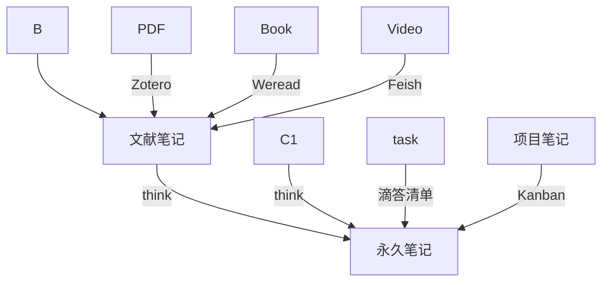

# 个人效率系统工作流

## 📌 核心定义

> A1[web] -->|Cubox| B[收集箱]

## 🎯 关键要点

- A1[web] -->|Cubox| B[收集箱]
- A2[rss] -->|Edge| A1
- B2[类型/日记] -->|Obsidian| C1[闪念笔记]
- C --> |think| E[永久笔记]
- C1 --> |think| E[永久笔记]
- task --> |滴答清单| E[项目笔记]
- D[项目笔记] --> |Kanban| E[永久笔记]
- F[PDF] -->|Zotero| C

## 📖 详细说明

### 概念解释
A1[web] -->|Cubox| B[收集箱]
A2[rss] -->|Edge| A1
B2[类型/日记] -->|Obsidian| C1[闪念笔记]

### 实际应用

每日使用 Cubox 和 Edge 自动聚合网页与 RSS 信息至收集箱，并通过 Zotero 和 WeRead 将 PDF 及电子书转化为文献笔记；利用 Obsidian 记录闪念、滴答清单管理任务生成项目笔记，最后通过 Kanban 视图梳理项目进展，将所有素材统一沉淀为永久笔记以构建知识网络。

## 🔗 关联知识

- 73-文章
- 效率系统联动与配合
- 信息管理系统
- 我的笔记系统
- 个人任务管理系统
- [个人输出发布系统](../md-47ba9881/)

## 📚 参考资料

- 来源：`01-BRAIN/11-概念/C7-自我与成长/个人效率系统工作流.md`

## 💡 个人理解

我的理解：这条流水线的核心是只有一个入口——无论来自 RSS 还是网页，先进收集箱再统一处理；入口多了，系统一定会在某处漏水。

## 📊 元数据

| 属性 | 值 |
|------|-----|
| 分类代码 | 06-Cognitive-Psychology |
| 知识类型 | concept |
| 来源文件 | 01-BRAIN/11-概念/C7-自我与成长/个人效率系统工作流.md |
| 精修时间 | 2026-06-17 11:53 |

---

## 调用示例

场景 1：判断「个人效率系统工作流」是否适用时，先复述其核心——A1[web] -->|Cubox| B[收集箱]——再对照当前事实逐项核对。
场景 2：遇到与「个人效率系统工作流」相似的模糊情形，以要点「- A1[web] -->|Cubox| B[收集箱]」为检查清单，避免只凭印象下结论。

## 边界约束

- 适用范围：本词条属 06-Cognitive-Psychology 类 concept，用于理解与复盘「个人效率系统工作流」相关判断。
- 不适用：不替代该领域的专业判断；原始来源标注为「01-BRAIN/11-概念/C7-自我与成长/个人效率系统工作流.md」。
- 前置条件：需先确认上文核心定义与关键要点，且信息来自可核实的一手材料。
- 风险提示：状态为「draft」；记忆转述可能偏差，关键决策请回查一手来源。

---

来源与口径

- 来源：`zhubao315/obsidian-vault@main:02-BUILD/23-uWise`
- 私库路径：`词条/个人效率系统工作流.md`
- 原始状态：draft · 分类：06-Cognitive-Psychology
- 断链别名（无目标，保留为文本）：5 条
- 本页由每周同步自动生成；内容来自个人笔记，未经逐条核验。

